# Medical VQA: CLIP-Based Classifiers vs. Vision-Language Models, with Explainability-Driven Hallucination Assessment

**Undergraduate thesis (B.Sc. in Computer Science & Engineering), East Delta University, 2026**
Author: Julfikar Rahaman Asif · Supervisor: Tanvir Azhar, Assistant Professor

> Do medical VQA models answer correctly **for the right reasons**? This project fine-tunes four models on VQA-Med 2021 and checks, for every single prediction, whether the answer is actually grounded in the image.

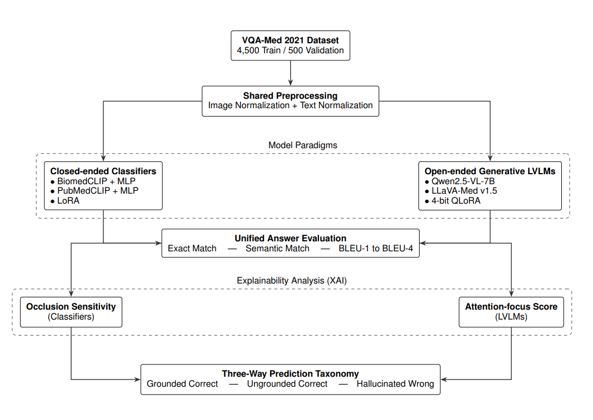

## Contents
1. [Summary](#summary)
2. [Motivation and problem](#motivation-and-problem)
3. [Dataset](#dataset)
4. [Methodology](#methodology)
5. [Results](#results)
6. [Explainability (XAI) results](#explainability-xai-results)
7. [Key findings](#key-findings)
8. [Limitations and future work](#limitations-and-future-work)
9. [Repository layout and how to run](#repository-layout-and-how-to-run)
10. [Thesis, slides and weights](#thesis-slides-and-weights)
11. [Citation and license](#citation-and-license)

---

## Summary

Medical Visual Question Answering (Med-VQA) systems are usually judged only by exact-match accuracy, which cannot tell whether an answer came from the image or from a lucky guess. This work compares two model families under one protocol:

- **Contrastive classifiers:** BiomedCLIP + MLP and PubMedCLIP + MLP (LoRA fine-tuned, 330-class answer vocabulary).
- **Generative LVLMs:** Qwen2.5-VL-7B-Instruct and LLaVA-Med v1.5 (Mistral-7B), 4-bit QLoRA fine-tuned.

All four are evaluated on 500 validation samples with exact match, BiomedBERT semantic match and BLEU-1 to BLEU-4. Each prediction is then labelled **Grounded Correct**, **Ungrounded Correct** or **Hallucinated Wrong** using occlusion sensitivity (classifiers) or an attention-based focus score (LVLMs).

**Headline result:** the smallest model, PubMedCLIP + MLP, was the most accurate (57.2% exact match) and had the lowest hallucination rate (39.8%), beating both 7B generative models despite having roughly 40x fewer parameters.

## Motivation and problem

Med-VQA could act as a second reader for radiologists, a study aid for students, or decision support where specialists are scarce. A wrong or ungrounded answer can mislead a clinician, so accuracy alone is not enough. Existing comparisons report accuracy or BLEU, which say nothing about *how* an answer was produced. This thesis asks whether correct answers are visually grounded, and compares a closed-vocabulary classifier against a free-text generator on the same benchmark.

**Objectives**
1. Fine-tune four Med-VQA architectures on VQA-Med 2021 with parameter-efficient methods (LoRA / QLoRA).
2. Evaluate all four under one metric protocol (exact match, semantic match, BLEU-1..4).
3. Apply an explainability pipeline suited to each family (occlusion sensitivity vs. attention-based grounding).
4. Classify every prediction into a three-way hallucination taxonomy and compare the distributions.

## Dataset

**VQA-Med 2021 (ImageCLEF)**: radiology images from the MedPix archive with clinical questions and answers; 4,500 training and 500 validation triplets. The dataset is **not** included in this repository (see [setup](#setup)).

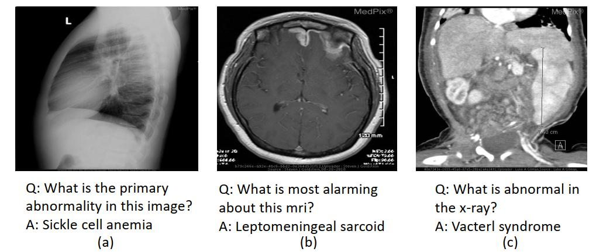

Dataset challenges that cap achievable accuracy for every model:
- **Small:** only 4,500 training samples for free-text diagnosis.
- **Long-tailed answers:** 330 normalized answer classes, most with very few examples.
- **Subjective questions:** many ask "what is abnormal?", so a defensible answer can differ from the single reference.
- **Look-alike diagnoses** across X-ray, CT, MRI, ultrasound and fluoroscopy (for example testicular torsion vs. epididymitis).
- **Shortcut cues:** images keep on-screen labels, calipers and annotations that a model can latch onto.

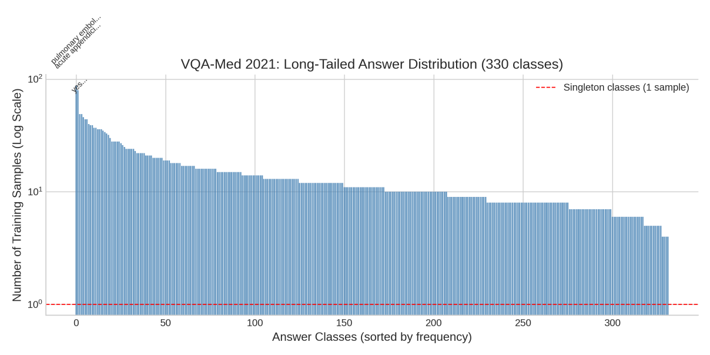

## Methodology

**Workflow (per model):** load data and preprocess, inject LoRA/QLoRA adapters, fine-tune on the 4,500-sample training split, evaluate on the 500-sample validation split, then run XAI on every validation prediction and assign a taxonomy label. Answer normalization (lower-casing, punctuation stripping, synonym parsing) is identical across all four pipelines.

### Models

| Model | Paradigm | Backbone | Fine-tuning | Trainable / total params |
|---|---|---|---|---|
| BiomedCLIP + MLP | Closed-vocabulary classifier | PubMedBERT text + ViT-B/16 image | LoRA (r=16) + MLP head | 4.4M / 200.3M |
| PubMedCLIP + MLP | Closed-vocabulary classifier | CLIP ViT-B/32 tuned on ROCO | LoRA (r=16) + MLP head | 3.71M / 155.0M |
| Qwen2.5-VL-7B-Instruct | Generative LVLM | Native-resolution ViT + LLM | 4-bit NF4 QLoRA (r=32) | 95.2M / 8.39B |
| LLaVA-Med v1.5 (Mistral-7B) | Generative LVLM | CLIP ViT + projector + Mistral-7B | 4-bit NF4 QLoRA (r=32) | 95M / 7.5B |

**Classifiers.** Image and question are encoded separately, each embedding is L2-normalized (512-d), concatenated (1024-d) and passed through an MLP head (1024 -> 512 -> 330, LayerNorm, ReLU, dropout) that predicts one of 330 answer classes. Validation answers outside the vocabulary count as wrong.

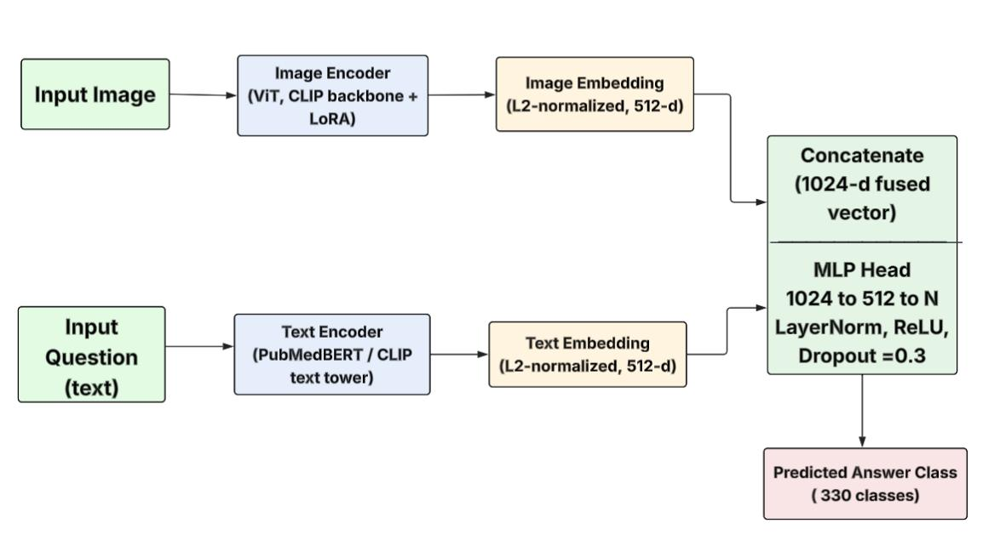

**Generative LVLMs.** Both use the same short-diagnosis system prompt (answer in at most six words), a 64-128 vision-token budget, and a masked causal-LM loss applied to the answer tokens only.

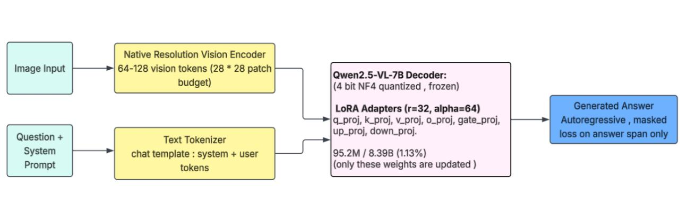
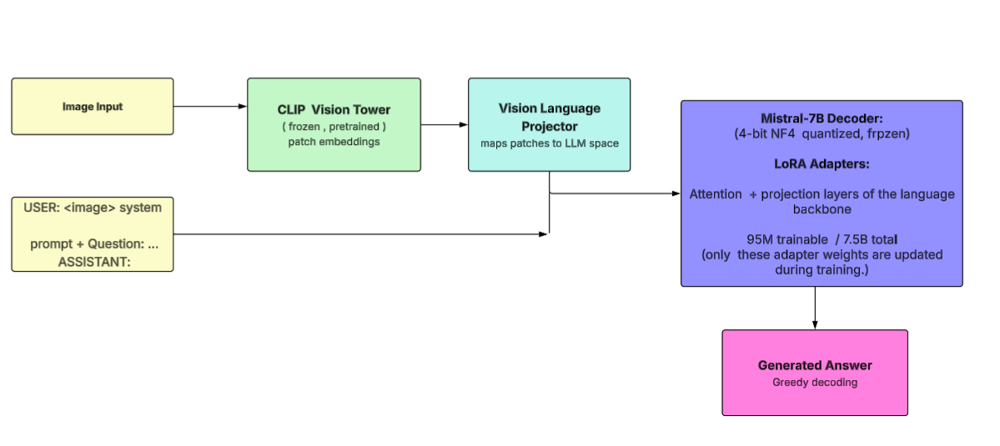

### Fine-tuning

- Classifiers: up to 30 epochs, AdamW, cosine schedule, gradient clipping 1.0; PubMedCLIP also uses label smoothing 0.1 and early stopping (patience 6).
- LVLMs: 5 epochs, paged 8-bit AdamW, cosine schedule with 50 warm-up steps, learning rate 2e-4, effective batch size 16 via gradient accumulation, on a single 16 GB T4.
- Best checkpoint kept per model (highest validation accuracy for classifiers, lowest validation loss for LVLMs). Full hyperparameters are in thesis Table 3.2 and the notebooks.
- Augmentation (classifiers only, geometry-preserving): small rotations and brightness/contrast jitter. No flips, because left-right orientation is clinically meaningful.

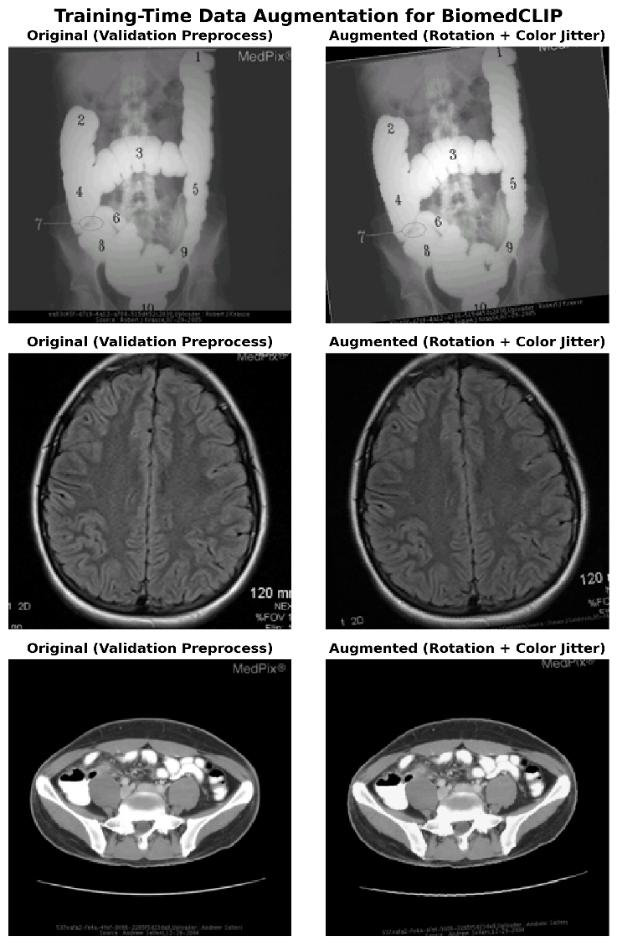
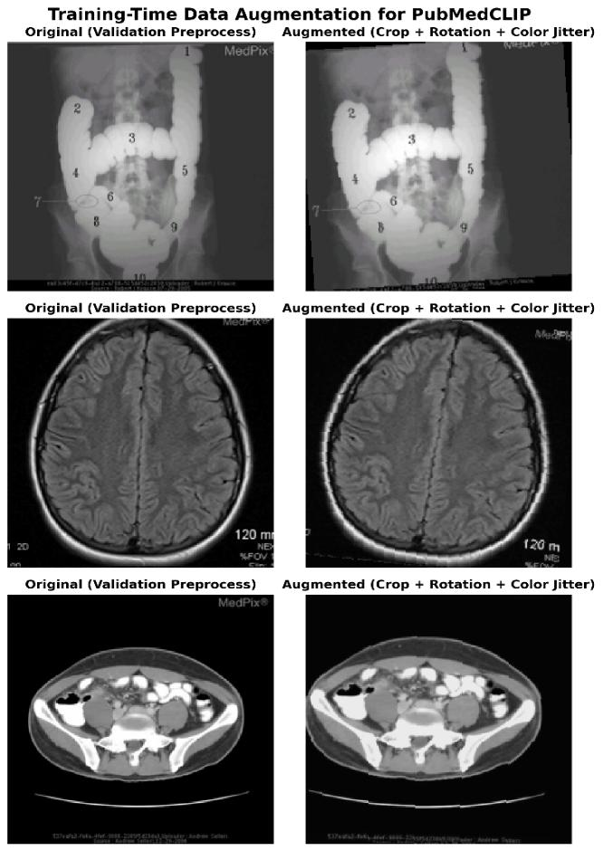
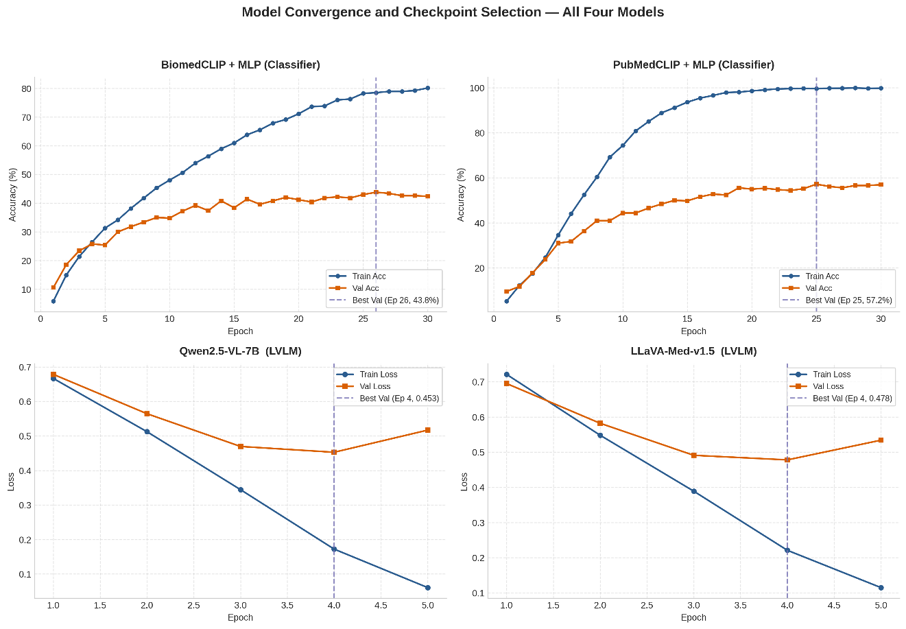

### Evaluation protocol

- **Exact match** against the accepted ground-truth synonyms.
- **Semantic match:** BiomedBERT mean-pooled embeddings, cosine similarity >= **0.96**, calibrated so that only a small share of known-wrong answers pass.
- **BLEU-1 to BLEU-4** and cumulative BLEU, following Lameesa et al.

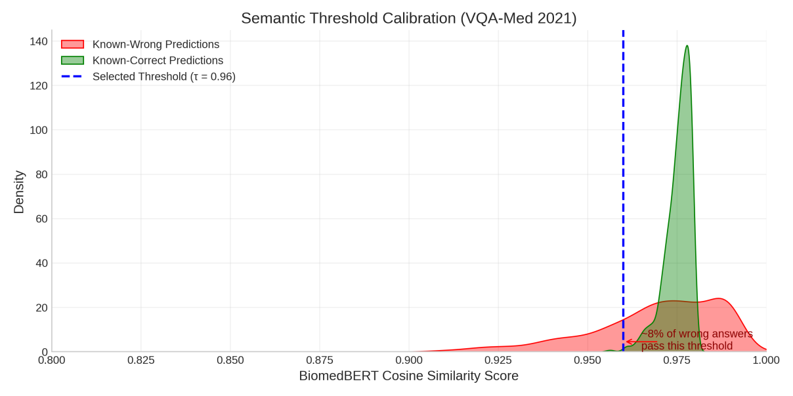

### Explainability and hallucination taxonomy

- **Classifiers: occlusion sensitivity.** Slide a gray patch across the image and record the largest drop in the predicted-class probability. A drop >= 0.10 means the prediction depends on a localizable region.
- **LVLMs: attention-based focus score.** Two stages: (A) generate the answer with default attention; (B) re-run a teacher-forced pass with eager attention, collect later-layer attention from answer tokens to image patches, and convert its entropy into a focus score (low entropy = focused). Thresholds are calibrated per model.

| Label | Rule |
|---|---|
| **Grounded Correct** | Semantic match **and** grounding signal above threshold |
| **Ungrounded Correct** | Semantic match but grounding signal below threshold |
| **Hallucinated Wrong** | No semantic match |

## Results

### Accuracy and BLEU (500 validation samples)

| Model | Exact match | Semantic match | BLEU-1 | BLEU-2 | BLEU-3 | BLEU-4 | Cum. BLEU |
|---|---|---|---|---|---|---|---|
| BiomedCLIP + MLP | 43.80% | 48.20% | 46.41 | 35.53 | 21.18 | 12.09 | 25.49 |
| **PubMedCLIP + MLP** | **57.20%** | **60.20%** | **58.44** | **46.16** | **29.71** | **16.38** | **28.26** |
| Qwen2.5-VL-7B | 41.80% | 43.40% | 43.65 | 33.27 | 17.75 | 10.18 | 22.63 |
| LLaVA-Med v1.5 | 43.20% | 47.00% | 44.71 | 33.40 | 18.43 | 9.98 | 22.89 |

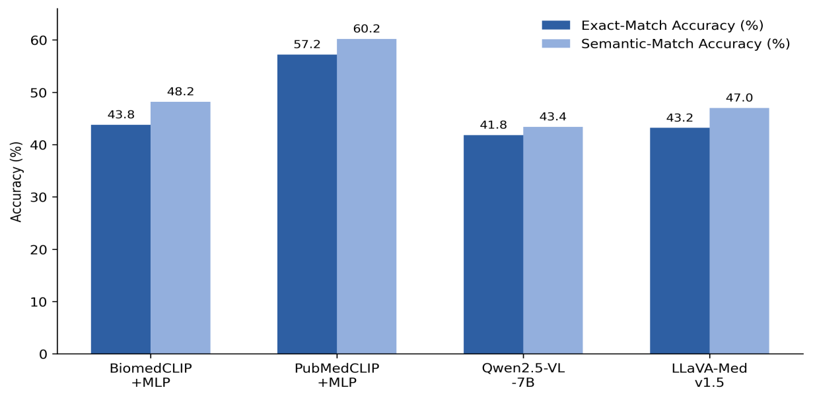

### Hallucination taxonomy (n = 500 per model)

| Model | Grounded Correct | Ungrounded Correct | Hallucinated Wrong |
|---|---|---|---|
| BiomedCLIP + MLP | 42.4% | 5.8% | 51.8% |
| **PubMedCLIP + MLP** | **57.2%** | 3.0% | **39.8%** |
| Qwen2.5-VL-7B | 22.6% | 20.8% | 56.6% |
| LLaVA-Med v1.5 | 30.8% | 12.4% | 56.8% |

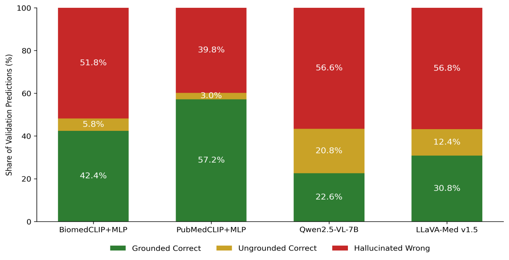

Almost half of Qwen2.5-VL's correct answers (20.8 of 43.4 points) were ungrounded, versus about 7% of PubMedCLIP's. LLaVA-Med was better grounded than Qwen (about 2.5 grounded answers per ungrounded one) but hallucinated just as often.

### Context: published VQA-Med 2021 challenge results

| System | Accuracy (%) | BLEU | Notes |
|---|---|---|---|
| SYSU-HCP (1st place) | 38.2 | 0.416 | Ensemble, cross-year training data |
| Yunnan University (2nd) | 36.2 | 0.402 | VGG16 + BioBERT, 2021 data only |
| BBN-Orchestra (3rd) | 34.8 | 0.391 | Long-tail-aware fusion |
| BiomedCLIP + MLP (ours) | 43.8 | 0.464 | Single model, 2021 data only |
| PubMedCLIP + MLP (ours) | 57.2 | 0.584 | Single model, 2021 data only |
| Qwen2.5-VL-7B (ours) | 41.8 | 0.437 | Single model, QLoRA |
| LLaVA-Med v1.5 (ours) | 43.2 | 0.447 | Single model, QLoRA |

> **Read with care:** challenge numbers are the teams' official results, while ours are on the 500-sample validation split, so this is a context comparison, not a like-for-like ranking. BiomedCLIP and PubMedCLIP were also released after the 2021 challenge, which the thesis argues explains much of the gap (better domain-adapted backbones, not new task-specific methods).

## Explainability (XAI) results

For every example below, the title or overlay reports the ground truth, the prediction and the taxonomy label.

### Classifiers: occlusion-sensitivity maps

Grounded Correct examples show a large confidence drop concentrated on the relevant anatomy (BiomedCLIP "chloroma": drop 0.3945; PubMedCLIP "ganglioneuroma": drop 0.4502). Ungrounded Correct examples show a tiny, diffuse drop (0.0591 and 0.0441). A large drop does not guarantee a correct diagnosis: PubMedCLIP predicted "c spine fracture" with a 0.4552 drop where the truth was a more specific finding, so the model was looking at the right region but answered wrong.

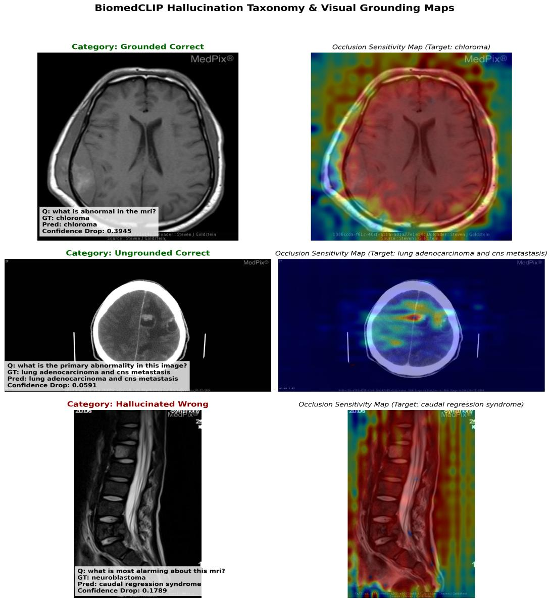
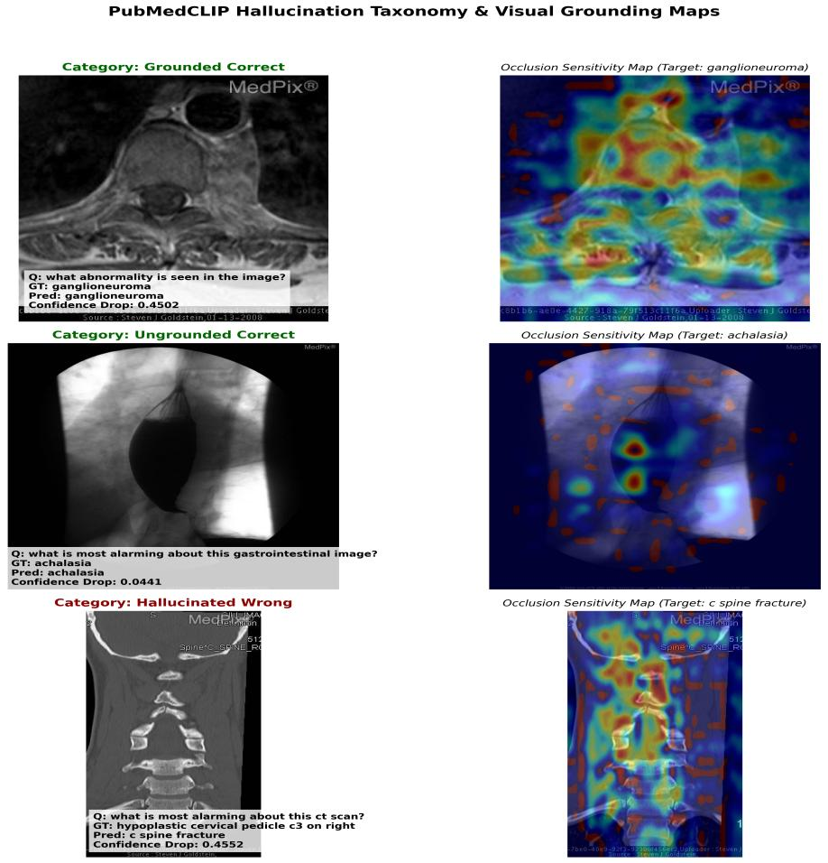

### Qwen2.5-VL-7B: attention overlays

| Grounded Correct (hiatal hernia) | Ungrounded Correct (meniscal tear) | Hallucinated Wrong (GT azygous lobe, predicted pneumomediastinum) |
|---|---|---|
| 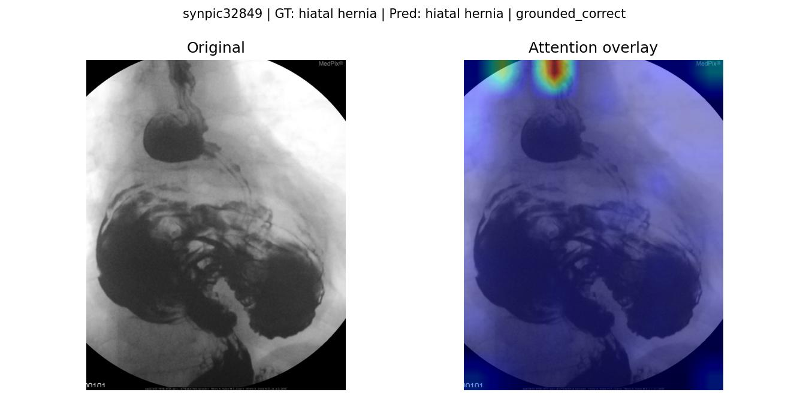 | 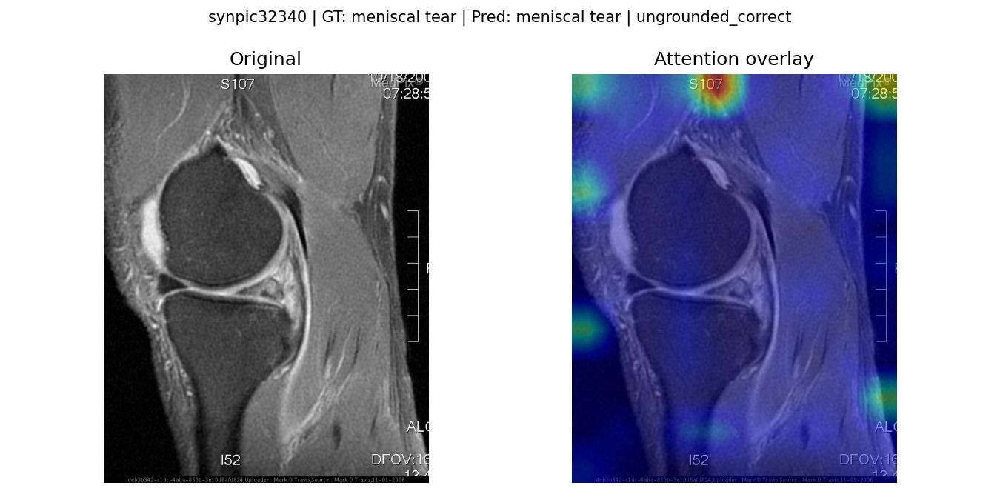 | 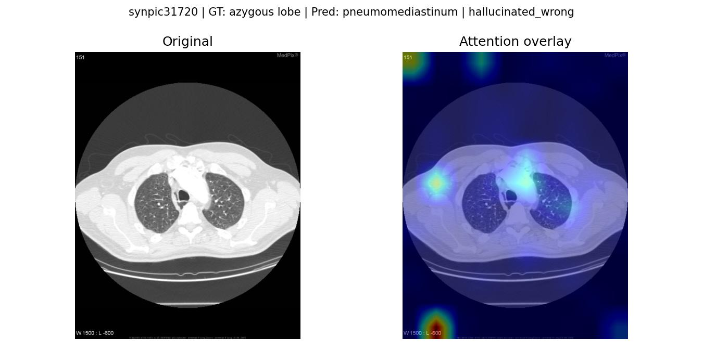 |

### LLaVA-Med v1.5: attention overlays

| Grounded Correct (adenomyomatosis) | Ungrounded Correct (diastematomyelia) | Hallucinated Wrong (GT testicular torsion, predicted epididymitis) |
|---|---|---|
| 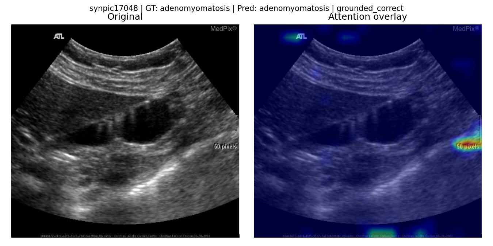 | 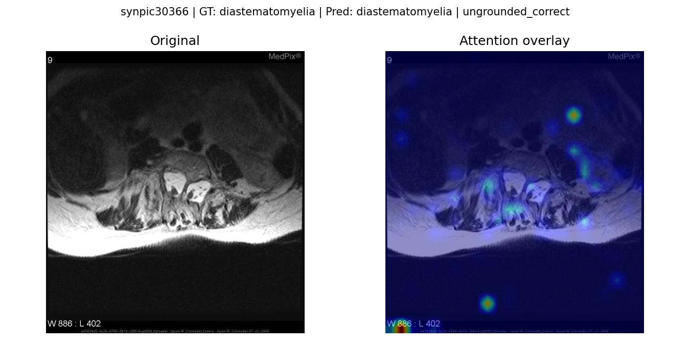 | 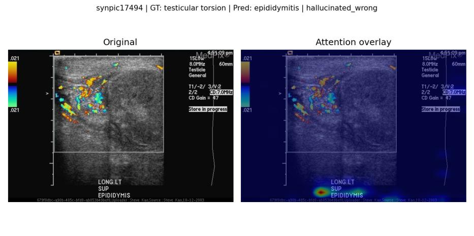 |

In the LLaVA-Med error case the attention sits on the on-screen "EPIDIDYMIS" label rather than the Doppler flow signal, suggesting the model was misled by text in the image.

## Key findings

1. **Scale did not buy accuracy or grounding.** The 155M-parameter PubMedCLIP classifier (3.71M trainable) beat both 7B LVLMs on accuracy and had far fewer hallucinations.
2. **Pretraining data match matters more than size.** PubMedCLIP (radiology-focused ROCO) beat BiomedCLIP (larger but broader PubMed Central corpus that includes non-radiology figures).
3. **A closed vocabulary limits fluent-but-fake answers.** The classifiers cannot invent a diagnosis outside the 330 classes, though any out-of-vocabulary ground truth is automatically wrong.
4. **Accuracy hides grounding.** Ungrounded Correct answers look identical to grounded ones under exact match or BLEU; only the XAI pipeline separates them.
5. **LVLM errors are plausible, not random.** Wrong answers are usually clinically adjacent to the truth, pointing to language-level priors, and sometimes to reading on-screen text instead of the pathology.

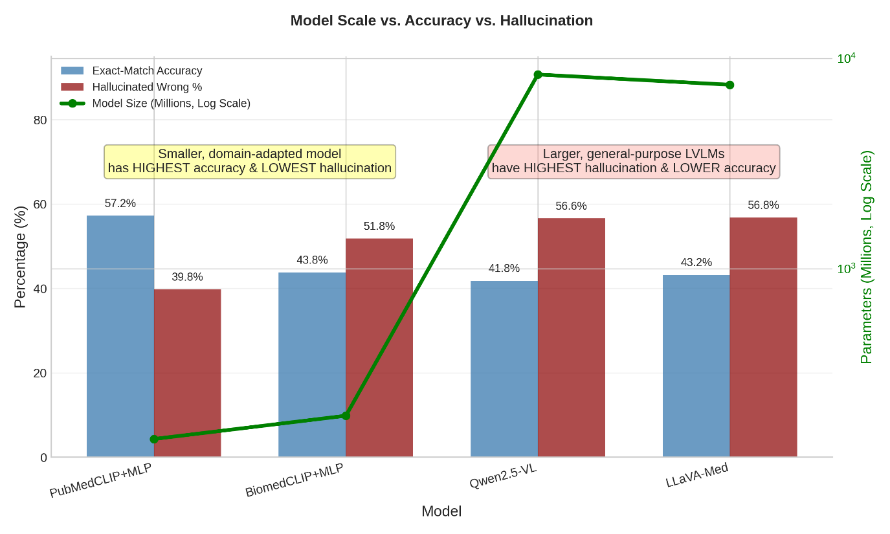

## Limitations and future work

**Limitations:** one small dataset (4,500 / 500); a 5-epoch QLoRA schedule on a single T4; grounding scores calibrated separately per model family, so they are not on one shared scale; severe train/validation shift (113 of 233 unique validation answer classes appear only once in training); the fixed 330-class vocabulary creates an out-of-vocabulary failure mode the LVLMs do not share.

**Future work:** repeat the study on VQA-RAD and SLAKE; explore hybrids that use a grounded classifier prediction as a retrieval or verification signal for a generative model.

## Repository layout and how to run

```
notebooks/
  01_biomedclip_mlp.ipynb      # train + eval + occlusion XAI
  02_pubmedclip_mlp.ipynb      # train + eval + occlusion XAI
  03_qwen25vl_qlora.ipynb      # train + eval
  03b_qwen25vl_xai.ipynb       # attention-based hallucination analysis
  04_llava_med_qlora.ipynb     # train + eval
  04b_llava_med_xai.ipynb      # attention-based hallucination analysis
figures/                       # all figures used in this README
docs/                          # thesis PDF and defense slides (if cleared for release)
requirements.txt
```

### Setup
1. Get **VQA-Med 2021** from the [ImageCLEF VQA-Med 2021 page](https://www.imageclef.org/2021/medical/vqa) (not redistributed here).
2. Set the paths at the top of each notebook:
   ```python
   TRAIN_TXT  = "data/train/QA/Train_QA_pairs.txt"   # pipe-separated: image_id|question|answer
   VAL_TXT    = "data/val/QA/Val_QA_pairs.txt"
   TRAIN_IMGS = "data/train/images"
   VAL_IMGS   = "data/val/images"
   OUTPUT_DIR = "outputs/<model_name>"
   ```
   Adjust file names to match your copy of the dataset.
3. `pip install -r requirements.txt`
4. Hardware used: one Kaggle **T4 (16 GB)**.

### Reproducing
Run each notebook top to bottom. Training saves the best checkpoint, evaluation writes a metrics CSV, and the XAI step reads that CSV plus the saved adapter to produce taxonomy labels and overlays. For the LVLM XAI notebooks, point `EVAL_CSV` and `ADAPTER_DIR` / `ADAPTER_PATH` at your own outputs.

## Thesis, slides and weights

- Thesis (PDF): `docs/222004812_Thesis_Report.pdf` _(add only if your university allows public release)_
- Defense slides: `docs/Defense_Presentation.pptx` _(add your file)_
- Trained LoRA adapters: Hugging Face Hub _(add link)_

## Citation and license

```bibtex
@thesis{asif2026medvqa,
  author = {Asif, Julfikar Rahaman},
  title  = {Comparative Analysis of CLIP-Based and Vision-Language Models for Medical Visual Question Answering with Explainability Driven Hallucination Assessment},
  school = {East Delta University},
  year   = {2026}
}
```

Code is released under the MIT License (see `LICENSE`). The VQA-Med 2021 dataset and the pretrained models (BiomedCLIP, PubMedCLIP, Qwen2.5-VL, LLaVA-Med) keep their own licenses.

**Acknowledgments:** ImageCLEF VQA-Med 2021 organizers; the BiomedCLIP, PubMedCLIP, Qwen2.5-VL and LLaVA-Med teams; OpenCLIP, PyTorch, Hugging Face Transformers and PEFT.
